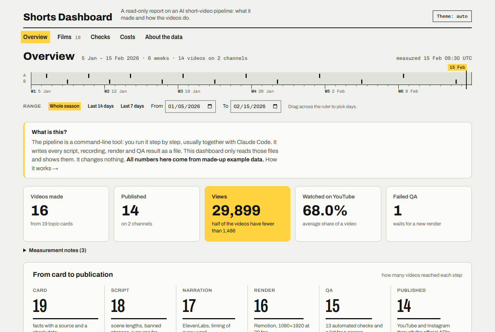
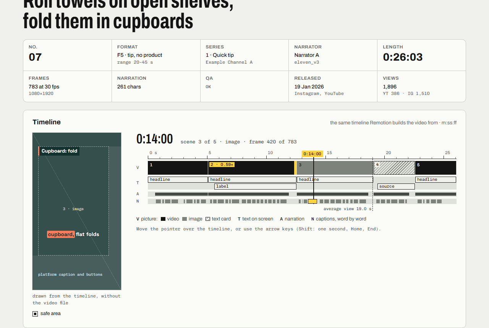
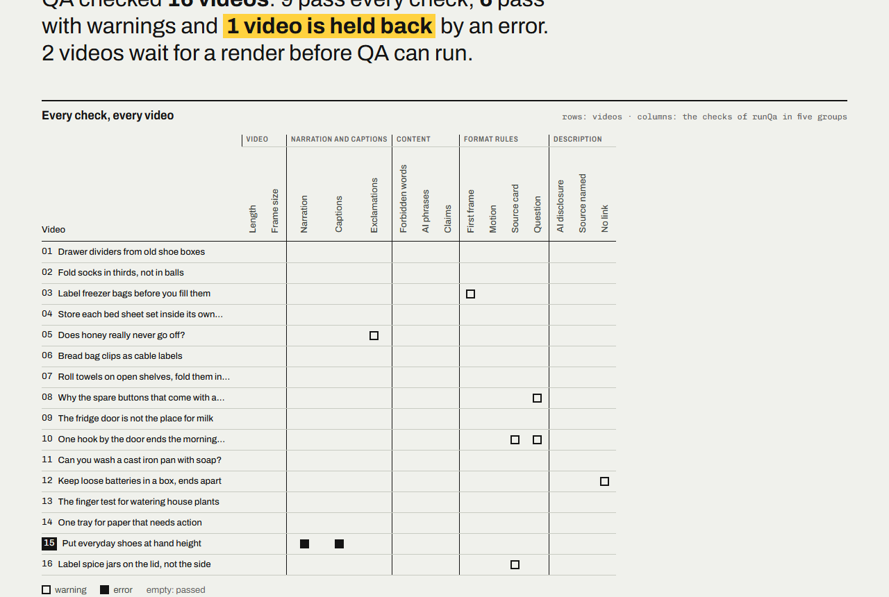
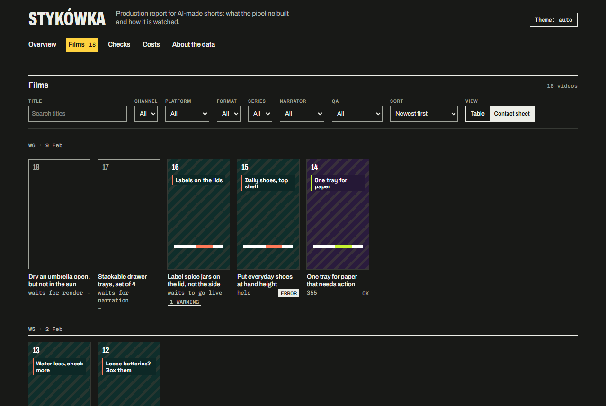

# shorts-pipeline

A TypeScript CLI that turns fact-checked content cards into vertical short videos (9:16) and publishes them.

```
topic / product card (JSON, validated with Zod)
  → script checks (scene lengths, banned phrases, facts only from the card)
  → narration with ElevenLabs + word-level timings
  → Remotion render (captions synced to words, overlays, series theme)
  → automated QA (duration, loudness, caption, disclosure, sources)
  → publishing to YouTube Shorts and Instagram Reels via official APIs
  → stats snapshot (YouTube Analytics, Instagram Insights)
```

You run it from the terminal, one step at a time – in practice together with Claude Code, which writes the scripts and fixes what QA flags. The engine is generic. Everything specific to a channel – channel list, narrators and voices, series names, language, disclosure text, content cards – lives in a separate **content directory** that is not part of this repo.

## Requirements

- Node.js 24 (see `.nvmrc`), pnpm 9
- ffmpeg on `PATH` (audio checks, flow clips)
- Optional, per step: ElevenLabs API key, a Google OAuth client (YouTube), an Instagram system-user token

## Repository layout

A pnpm workspace:

```
pipeline/            the CLI (this README)
packages/schema/     Zod schemas, types and video constants shared by every package
packages/timeline/   pure timeline functions: caption lines, timecode, scene lookup
packages/mock/       deterministic mock content generator (seeded, no real data)
fixtures/content/    its output: a complete example content directory, committed
dashboard/           Shorts Dashboard: static Next.js report on the mock data
```

## Shorts Dashboard

How the pieces fit:

- **The pipeline does the work.** A CLI you run one step at a time, usually together with Claude Code. You bring the facts, the script and the clips; it records the narration, renders, checks and publishes on your command. Every step leaves a file.
- **The dashboard only reads.** A static report built from those files: what was made, whether it passed QA, what it cost and how it is watched. It has no buttons and changes nothing; the pipeline works the same without it.
- **On GitHub Pages it shows mock data only.** Every number is made up; the code that makes, checks and counts the videos is real. To see your own videos, build it locally on your content folder ([docs/getting-started.md](docs/getting-started.md), step 7).



| View | What it answers |
| --- | --- |
| Overview | What did the pipeline make in a date range, and how do the videos start? A ruler of the season picks the range. |
| Films | Which video? A table or a contact sheet, with filters, sort and columns. |
| Film | How is one video built? A frame preview drawn from the timeline, four tracks under a playhead, the edit list, QA, releases, narration cost, claims and their facts. |
| Checks | Where does QA flag problems? A matrix of videos × checks, the checks that flag most, the videos held back. |
| Costs | What did narration and clips cost? Characters per video, the monthly limit, generator credits, characters per 1,000 views. |
| About the data | Where the numbers come from, what is real, how they are counted. |





How it is built:

- **Next.js 16 static export**, Tailwind 4 with its default theme switched off in favour of its own tokens, self-hosted fonts, light and dark themes.
- **Data at build time.** The build reads a content directory, validates every file with `@shorts/schema` and joins videos with their publications, stats and narration costs. A broken file stops the build with its path and field.
- **Charts without a chart library.** They render on the server to SVG and HTML, read the same without JavaScript (it only adds the hover and keyboard readout), and every chart has its numbers in a table. `/patterns/` shows each chart form.
- **State in the address.** The Overview range, the Films filters and view, and the Film playhead (`?t=` in frames) live in the URL, so a link reproduces the view.
- **The preview is the render.** The Film preview uses the same caption function (`@shorts/timeline`) as the Remotion composition, and a test checks it against `compose-*.json` word by word.
- **Tests.** Vitest covers the data layer, scales and the look rules of the review checklist (no stray colour, gradient, radius or stock font). Playwright with axe checks every view in both themes and at phone width, compares every view with reference screenshots (kept per platform), and scans the built site for anything that is not `example.com`.



```sh
pnpm --filter @shorts/dashboard dev     # http://localhost:3000
pnpm --filter @shorts/dashboard build   # static site in dashboard/out
pnpm --filter @shorts/dashboard e2e     # end-to-end tests on the built site
```

`pnpm mock` regenerates `fixtures/content/`: 17 topic videos and a product video over a six-week season, with scripts, narration timings, timelines, QA results, publications, daily stats snapshots and the voice ledger. The scripts, timelines and QA results are produced by the pipeline's own functions; only the TTS and the platform numbers are simulated. The same seed always gives byte-identical files, and a test fails when the committed fixtures are out of date.

## Quick start

Who does what, in plain words: [docs/how-it-works.md](docs/how-it-works.md). Step by step from a fresh clone to your own videos, posts and dashboard: [docs/getting-started.md](docs/getting-started.md).

```sh
pnpm install           # from the repo root
pnpm typecheck         # all packages
pnpm test              # all packages
cd pipeline
pnpm validate          # checks every card in the content directory
```

Without a content directory the pipeline runs on `examples/` (example config with two channels, two narrators and two series).

## Content directory

Set `CONTENT_DIR` to a folder with your own content (default: the `pipeline/` folder itself):

```
my-content/
  shorts.config.json   # channels, narrators, series, language, disclosure
  .env                 # secrets – see pipeline/.env.example
  topics/<id>.json     # topic cards
  products/<id>.json   # product cards
  flows/<name>.json    # step-by-step plans for generated clips
  assets/              # images, character cutouts
  out/                 # renders, audio, QA reports (generated)
  data/                # publications.csv, stats/<date>.json, voice-ledger.csv (generated)
```

### Generated data files

Besides videos and Markdown reports, the pipeline writes machine-readable files (validated against `@shorts/schema` before writing):

| File | Written by | Contents |
| --- | --- | --- |
| `out/<date>-<id>-<format>/compose-<narrator>.json` | `pnpm compose` | the timeline the video is rendered from: scenes and caption words in frames |
| `out/<date>-<id>-<format>/qa-<narrator>.json` | `pnpm qa` | QA checks (`ok` / `warning` / `error`), manual checklist, pass flag |
| `data/voice-ledger.csv` | `pnpm make --narrator`, `pnpm voice-fix --takes` | characters per narration request: `date, film, narrator, model, kind (full/take/cache), scene, chars` |
| `data/stats/<date>.json` | `pnpm stats --save` | account and per-video stats snapshot |

`shorts.config.json` – see [`examples/shorts.config.example.json`](pipeline/examples/shorts.config.example.json):

| Key | Meaning |
| --- | --- |
| `channels[]` | `id` (lowercase, used in env names, e.g. `YT_REFRESH_TOKEN_A`), `name`, `youtubeCategoryId` |
| `narrators[]` | `id`, `name`, ElevenLabs `voiceId` or `voiceIdEnv`, `model`, optional `languageCode`, `stability` |
| `series` | number → series title shown on the opening card |
| `language` | BCP-47 language of the videos (YouTube metadata) |
| `sourceLabel` | label of the source card at the end of a video |
| `disclosure` | sentence every caption must contain (AI disclosure); QA fails without it |
| `voiceCharsPerMonth` | optional: characters per month in the voice plan, shown against usage in the dashboard |

## Commands

All commands run from `pipeline/`; each one prints its own help with `--help`.

| Command | What it does |
| --- | --- |
| `pnpm validate` | validates topic and product cards |
| `pnpm make --topic <id> --format F5 [--narrator <id>]` | script checks, narration, render |
| `pnpm compose …` | re-renders a video from existing narration (`--still` for a single frame) |
| `pnpm voice-fix … --scene <n> --takes <k>` | records alternative takes of one scene, `--apply <take>` swaps it in |
| `pnpm qa …` | QA report for a rendered video |
| `pnpm flow <plan>` | walks through a plan of generated clips, tracks status, converts and stitches clips |
| `pnpm yt-auth` / `pnpm yt-publish` | OAuth (PKCE) for a channel / upload a Short with metadata |
| `pnpm ig-publish` | publishes a Reel through the Instagram Graph API |
| `pnpm stats` | snapshot of account and video stats into `data/stats/` |
| `pnpm voice-samples` | browse and save ElevenLabs voice samples, check character usage |

Publishing is always one video at a time, started by a person – there is no bulk upload.

## Tech

TypeScript (strict), Zod 4 schemas, Remotion 4 + React 19, ElevenLabs SDK, YouTube Data & Analytics API, Instagram Graph API, `node:test`.

## Licence

Code: [MIT](LICENSE).

**Remotion is not MIT.** It uses its own [Remotion License](https://www.remotion.dev/license): free for individuals and companies with up to 3 employees; larger companies need a company licence. Check it before using this pipeline commercially.
